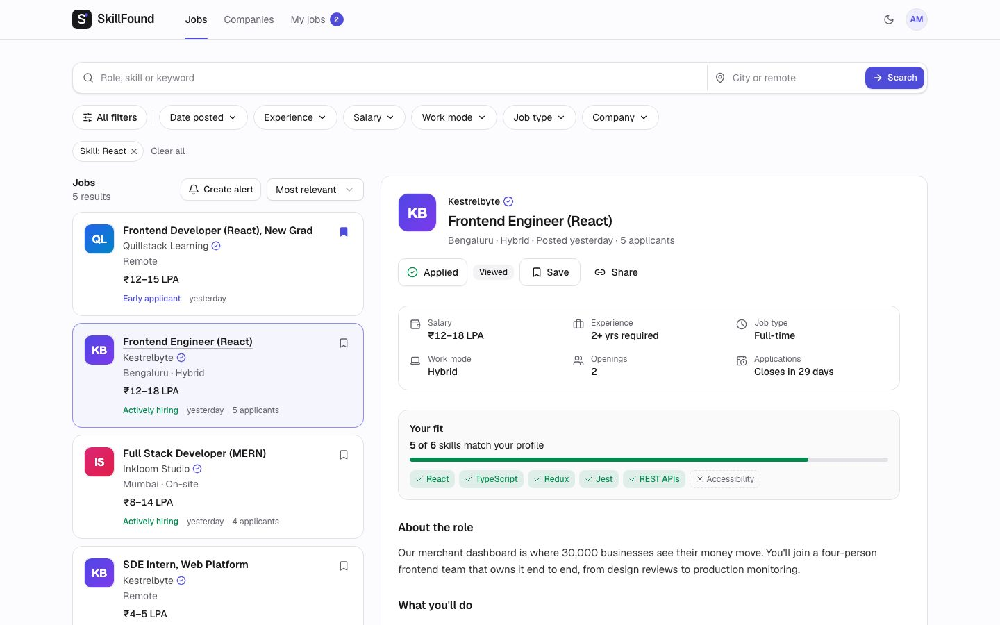

# SkillFound

A job board for engineering, data, design and product roles in India. Every listing shows its salary, you can see how well you fit a role before applying, and every application tells you where it stands.

**[Try it → skillfound-jobs.onrender.com](https://skillfound-jobs.onrender.com)**

No sign-up needed: use **Candidate** or **Recruiter** in the bar at the top of the site to look around with a demo account. The first visit can take up to a minute while the site wakes up. Companies, jobs and applicants are fictional sample data.

## If you're looking for a job

- **Search the way you'd say it.** "Remote React roles over 12 LPA for freshers" turns into filters you can see and remove.
- **Know your fit before you apply.** Every job gets a match score with the reasons behind it and the skills you're missing.
- **Fill your profile from your resume.** Upload a PDF, review what was drafted, and save.
- **Never apply into a black hole.** Each application shows its status, from applied to viewed, shortlisted, interview and offer. Long silences are labelled, not hidden.
- **Save jobs and set alerts** for searches you care about.

## If you're hiring

- **Post a job from a few notes.** A full description, responsibilities and skills are drafted for you to edit.
- **See your best applicants first.** Applicants are ranked by fit, with a one-line reason for each, judged on skills and experience only.
- **Run your pipeline in one place.** Move people through each stage and see your counts at a glance.

## Fixes for what people hate about job sites

| The usual problem | On SkillFound |
| --- | --- |
| Hidden salaries | Every job must show a salary range. |
| Ghost and stale listings | Jobs expire after 30 days unless the employer renews them. |
| Applying and hearing nothing | Every application has a visible status that employers' actions keep up to date. |
| Sign-in walls | Browse jobs and companies freely; sign in only to apply or save. |
| Spam calls | Your phone number stays hidden until an employer shortlists you. |
| Scam listings | Every job can be reported, and employers never ask for money. |

---

Want to run it yourself or contribute? See [docs/DEVELOPMENT.md](docs/DEVELOPMENT.md).

Built by [Dhairya Shah](https://dhairya-shah.onrender.com/) · [LinkedIn](https://www.linkedin.com/in/dhairyashah03/)
