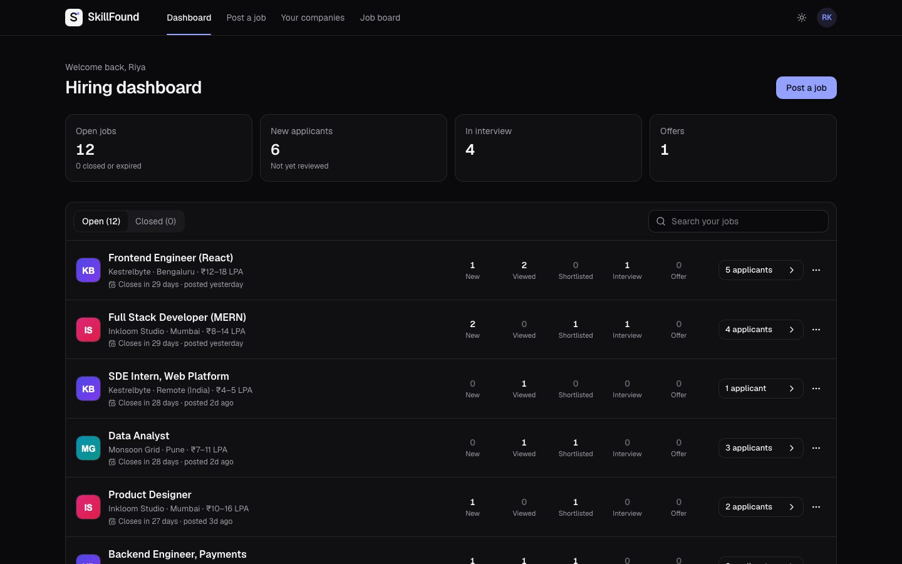

# SkillFound

SkillFound is a job board for engineering, data, design and product roles in India. Every listing shows its salary. Job seekers can see how their skills match a role before applying and follow each application through to a decision. Employers post clear roles and work through a ranked, stage-by-stage pipeline. It is a full MERN application, with Google Gemini for resume parsing, match scores, plain-English search and recruiter tools. Each AI feature is optional and falls back cleanly when Gemini is unavailable.

- **Live app:** [skillfound-jobs.onrender.com](https://skillfound-jobs.onrender.com)
- **API health:** [skillfound-jobs-api.onrender.com/api/v1/health](https://skillfound-jobs-api.onrender.com/api/v1/health)

The free Render instance sleeps when idle, so the first request can take up to a minute. To look around without signing up, use the **Candidate** or **Recruiter** links in the bar at the top of the site, or **Continue with a demo account** on the login page. Companies, jobs and applicants are fictional sample data.




## Features

### For job seekers

- **Search:** what and where fields, dropdown filters (date posted, experience, salary, work mode, job type, company), an "All filters" sheet, and sorting by relevance, date, pay or best match.
- **Results:** two panes on desktop, with the list on the left and the selected job's details on the right (the selection is kept in the URL). Phones get full job pages.
- **Cards:** salary in LPA, location and work mode, posted time, applicant count, and at most one earned badge: "Actively hiring" (employer active in the last 7 days) or "Early applicant" (fewer than 3 applicants). Every card has a bookmark.
- **Job pages:**
  - key facts (salary, experience, job type, work mode, openings, closing date)
  - About the role, responsibilities, requirements, skills, and salary and benefits
  - a skills match against your profile that works without AI
  - company facts, similar jobs, share and report
- **Company pages:** size, industry, year founded, locations and open roles.
- **My jobs**, in three tabs:
  - **Applications:** each with a timeline (applied → viewed → shortlisted → interview → offer or not selected), driven by the employer's actions. After 14 days without an update it shows "No response yet".
  - **Saved jobs.**
  - **Alerts:** saved searches with new-match counts. These are in-app only; there are no emails yet.
- **Profile:** build it by hand or from a resume PDF.

### For employers

- **Hiring dashboard:** open and closed jobs, counts per pipeline stage, expiry dates, and close, extend or reopen.
- **Pipeline by stage** (new, viewed, shortlisted, interview, offer, not selected). Each applicant opens in a profile sheet that records "viewed", shows the skills overlap and moves the person to the next stage.
- **Job posts:** structured fields for the role, responsibilities, requirements, skills and benefits. A salary range is required.
- **Company profile:** tagline, industry, size, year founded, locations and logo.

### Built-in protections

| Common complaint | What SkillFound does |
| --- | --- |
| Ghost jobs and stale listings | Listings expire 30 days after posting unless the employer extends them. Closed or expired jobs leave search but stay readable. |
| Applying into a black hole | Every application shows its status history. Opening an application marks it viewed. Silence over 14 days is labelled, not hidden. |
| Sign-in walls | Search, job pages and company pages are public. Sign-in is only needed to apply, save or create an alert. |
| Hidden salaries | Salary is a required field and appears on every card. |
| Scam listings | "Report job" on every listing, a note that employers never ask for money, and a verified badge only for companies the SkillFound team set up. |
| Recruiter spam calls | Candidate phone numbers stay hidden until the employer shortlists them. |

## AI features

| Feature | Who | What it does |
| --- | --- | --- |
| Plain-English search | Everyone | "Remote React roles over 12 LPA for freshers" becomes visible, removable filters. |
| Resume autofill | Candidates | A PDF becomes a drafted headline, bio, skills and experience, reviewed before saving. |
| Match scores | Candidates | 0–100 with reasons and missing skills, on cards and job pages. Cached per user, job and profile version. |
| Job description drafts | Employers | A few notes become a role description, responsibilities and skills, all editable. |
| Applicant ranking | Employers | Applicants are ordered by fit, with a one-line reason each, judged on skills and experience only. |

### How it fails safely

All calls go through `backend/ai/gemini.js`, using the official `@google/genai` SDK (`models.generateContent` with a JSON response schema).

- **Model chain.** `gemini-3.5-flash-lite` → `gemini-3.6-flash` → `gemini-3.8-flash` by default (Flash-Lite first: it is the fastest and the one reliably answering on the free tier) (`GEMINI_MODEL`, `GEMINI_FALLBACK_MODELS`). If a model is overloaded, rate-limited, slow or not served for this key, the next one is tried within the same request.
- **Skip memory.** A model that just failed is skipped for 3 minutes, so later requests go straight to one that works.
- **Retry round.** If every model is busy, the chain pauses briefly (`AI_RETRY_PAUSE_MS`, default 1.2 s) and goes round once more.
- **Deadlines.** Each request has a local deadline (`AI_TIMEOUT_MS`, `AI_RESUME_TIMEOUT_MS`), shared across the chain. The SDK doesn't retry on its own.
- **Validated output.** Responses are checked against the schema before use. Invalid, truncated or empty output becomes a typed error, never bad data.
- **Circuit breaker.** A bad key or a model id unknown everywhere pauses AI for 10 minutes. The UI then hides AI features instead of failing on every request.
- **Free-tier caps.** In-memory limits per IP, per user, global per minute, and per day. Cache hits (repeat searches, scored jobs, unchanged rankings) don't count.
- **Graceful fallback.** Search falls back to keyword matching; other AI features hide or explain themselves. Browsing, applying and every employer action work without AI.
- **Privacy.** Prompts and responses are never logged. Ranking never sends names or contact details. The API key stays on the server.
- **`GET /api/v1/ai/health`.** Reports whether a key is configured, the model chain, the last model used, availability and the last failure (with the key redacted), without calling Gemini.

## Architecture

```
React SPA (Vite, Render static site)
   │  HTTPS, JWT in an HttpOnly cookie (bearer-token fallback for browsers that block third-party cookies)
   ▼
Express API (Render web service)
   ├─ MongoDB (Mongoose): users, companies, jobs, applications, saved jobs, alerts, reports, cached match scores
   ├─ Cloudinary: resumes, profile photos, company logos (local disk in development)
   └─ Google Gemini: AI features, behind the fallback layer above
```

- Non-GET API requests must carry an `X-Requested-With` header. The auth cookie is `SameSite=None`, and this header blocks cross-site form posts.
- Ownership is checked on every employer route.
- Demo accounts can't change their identity, and can't edit or close the sample companies and jobs.

## Tech stack

- **Frontend:** React 19, Vite 7, Tailwind CSS 4, Radix UI primitives (shadcn-style), Redux Toolkit with redux-persist, React Router 7, framer-motion, sonner, Geist font
- **Backend:** Node.js 22, Express 5, MongoDB with Mongoose 8, JSON Web Tokens, Multer, Cloudinary, `@google/genai`
- **Tooling:** `node:test`, ESLint, Render Blueprints

## Local development

Prerequisites: Node.js 22+ and Docker (or any MongoDB).

```bash
docker run -d --name skillfound-mongo -p 27017:27017 mongo:7

cd backend
cp .env.example .env        # set SECRET_KEY to a long random string
npm install
npm run seed                # sample companies, jobs, applications and the two demo accounts
npm run dev                 # http://localhost:8000

cd ../frontend
cp .env.example .env.local
npm install
npm run dev                 # http://localhost:5173
```

- **Without Cloudinary credentials,** uploads go to `backend/uploads/` in development. In production they need Cloudinary and fail with a clear message otherwise.
- **Without `GEMINI_API_KEY`,** the app runs with AI features hidden.
- **Demo accounts.** `demo.candidate@example.com` and `demo.recruiter@example.com` can only be entered through the demo links; password login is disabled for them. They are shared, so anything created with them is visible to other visitors.
- **Seeding.** `npm run seed` is idempotent: it upserts only the sample records it owns and refreshes their dates. `npm run seed:reset-demo` also removes jobs, companies, applications, saved jobs and alerts created through the demo accounts.

## Environment variables

### Backend (`backend/.env`)

| Variable | Required | Default | Purpose |
| --- | --- | --- | --- |
| `MONGO_URI` | yes | | MongoDB connection string |
| `SECRET_KEY` | yes | | JWT signing secret |
| `PORT` | | `3000` | HTTP port |
| `FRONTEND_URL` | | | Extra allowed CORS origins, comma-separated (`https://skillfound-jobs.onrender.com` and the retired `https://skillfound-frontend.onrender.com` are always allowed) |
| `PUBLIC_URL` | | `http://localhost:PORT` | Public base URL of the API, used for locally stored uploads |
| `CLOUD_NAME`, `API_KEY`, `API_SECRET` | in production | | Cloudinary credentials |
| `GEMINI_API_KEY` | for AI | | Google AI Studio key; AI features are off without it |
| `GEMINI_MODEL` | | `gemini-3.5-flash-lite` | First model in the chain |
| `GEMINI_FALLBACK_MODELS` | | `gemini-3.6-flash,gemini-3.8-flash` | Comma-separated fallbacks, tried in order |
| `AI_TIMEOUT_MS` | | `20000` | Deadline for one AI request across the whole chain |
| `AI_RESUME_TIMEOUT_MS` | | `30000` | Deadline for resume parsing |
| `AI_RETRY_PAUSE_MS` | | `1200` | Pause before the retry round when every model is busy |
| `AI_DAILY_CAP` | | `200` | Gemini calls per UTC day, all users |
| `AI_GLOBAL_RPM` | | `8` | Gemini calls per minute, all users |
| `AI_IP_HOURLY` | | `30` | AI calls per IP per hour |
| `AI_USER_HOURLY` | | `40` | AI calls per signed-in user per hour |
| `TRUST_PROXY` | | `1` | Express `trust proxy` hops, for per-IP limits and secure cookies |
| `NODE_ENV` | | | `production` enables production behaviour (also inferred on Render) |
| `MONGO_URI_TEST` | | `mongodb://127.0.0.1:27017/skillfound_test` | Database used by `npm test` (dropped before and after) |

### Frontend (`frontend/.env.local`)

| Variable | Default | Purpose |
| --- | --- | --- |
| `VITE_API_URL` | `https://skillfound-jobs-api.onrender.com` | Backend base URL |

## Deployment

`render.yaml` is a Render Blueprint for two services. To deploy, go to Render → New → Blueprint and pick this repository.

| Service | Type | Root | Build | Start / publish |
| --- | --- | --- | --- | --- |
| `skillfound-jobs-api` | Node web service | `backend` | `npm ci && (npm run seed \|\| echo "seed skipped")` | `npm start`, health check `/api/v1/health` |
| `skillfound-jobs` | Static site | `frontend` | `npm ci && npm run build` | `dist`, with every path rewritten to `index.html` |

- **Pre-set by the Blueprint:** `NODE_VERSION=22`, `NODE_ENV=production`, `FRONTEND_URL`, `PUBLIC_URL`, `VITE_API_URL` and a generated `SECRET_KEY`.
- **Set in the dashboard:** `MONGO_URI`, `GEMINI_API_KEY`, and the three Cloudinary variables.
- **Seeding:** the sample data re-seeds on every backend build; it only touches its own records.
- **After a deploy:** check `GET /api/v1/ai/health`, then run the AI smoke test below.

## Testing

```bash
cd backend && npm test                  # node:test suites
cd frontend && npm run lint && npm run build
```

The backend suites need a reachable MongoDB; they seed a throwaway test database. They cover:

- every Gemini failure mode, with the client stubbed: the fallback chain, skip memory and retry round, schema validation, the circuit breaker and rate limits
- each AI route degrading while the core flows keep working
- saved jobs, alerts, reports, application timelines and phone redaction
- job close/expiry and its effect on search, the sorts, similar jobs, company pages
- the overview counts, and the seed refreshing dates

The AI smoke test uses real Gemini quota (about six requests):

```bash
cd backend
npm run ai:smoke                                                         # local: needs GEMINI_API_KEY and seeded data
node scripts/ai-smoke.js --url https://skillfound-jobs-api.onrender.com  # deployed: signs in through the demo accounts
```

## API overview

| Method | Path | Access |
| --- | --- | --- |
| `POST` | `/api/v1/user/register`, `/login`, `/demo`, `/logout` | public |
| `GET` | `/api/v1/user/me` | signed in |
| `POST` | `/api/v1/user/profile/update` | signed in |
| `GET` | `/api/v1/job/get` (filters, `sort=relevant\|newest\|salary\|match`, pagination), `/job/get/:id`, `/job/:id/similar`, `/job/facets`, `/job/overview` | public |
| `POST` | `/api/v1/job/:id/report` | public |
| `GET` | `/api/v1/company/public/:id` | public |
| `POST` | `/api/v1/application/apply/:id` | candidate |
| `GET` | `/api/v1/application/get` | candidate |
| `GET` `PUT` `DELETE` | `/api/v1/me/saved`, `/me/saved/ids`, `/me/saved/:jobId` | candidate |
| `GET` `POST` `DELETE` | `/api/v1/me/alerts`, `/me/alerts/:id`, `POST /me/alerts/:id/seen` | candidate |
| `POST` | `/api/v1/job/post` | recruiter |
| `GET` | `/api/v1/job/getadminjobs` | recruiter |
| `POST` | `/api/v1/job/:id/status` (`close`, `reopen`, `extend`) | job owner |
| `POST` `GET` `PUT` | `/api/v1/company/register`, `/company/get`, `/company/get/:id`, `/company/update/:id` | recruiter (owner) |
| `GET` | `/api/v1/application/:id/applicants` | job owner |
| `POST` | `/api/v1/application/:id/view`, `/application/status/:id/update` | job owner |
| `GET` | `/api/v1/ai/status`, `/ai/health`, `/api/v1/health` | public |
| `POST` | `/api/v1/ai/search` | public |
| `POST` | `/api/v1/ai/match`, `/ai/resume` | candidate |
| `POST` | `/api/v1/ai/job-description`, `/ai/jobs/:id/rank` | recruiter / job owner |

## Project structure

```
backend/
  ai/            Gemini client, fallback chain, schemas, rate limits, AI tasks
  config/        environment parsing
  controllers/   route handlers (users, jobs, companies, applications, saved jobs and alerts, AI)
  middlewares/   auth, CSRF header check, uploads
  models/        Mongoose models
  routes/        Express routers
  scripts/       seed, seed data, AI smoke test
  test/          node:test suites
  utils/         query builder, categories, storage, caching helpers
  app.js         Express app; index.js connects to MongoDB and listens
frontend/
  public/        favicon, Open Graph image, sample resume
  src/
    components/  ui primitives, layout, jobs, applications, profile, AI, landing sections
    hooks/       data and state hooks (jobs, matches, saved jobs, alerts, session)
    lib/         API client, filters, formatting, search helpers
    pages/       routes, including admin/ for employers
    redux/       auth state
docs/            README screenshots
render.yaml      Render Blueprint
```

## Author

**Dhairya Shah**\
[LinkedIn](https://www.linkedin.com/in/dhairyashah03/) | [GitHub](https://github.com/dhairya0609)
